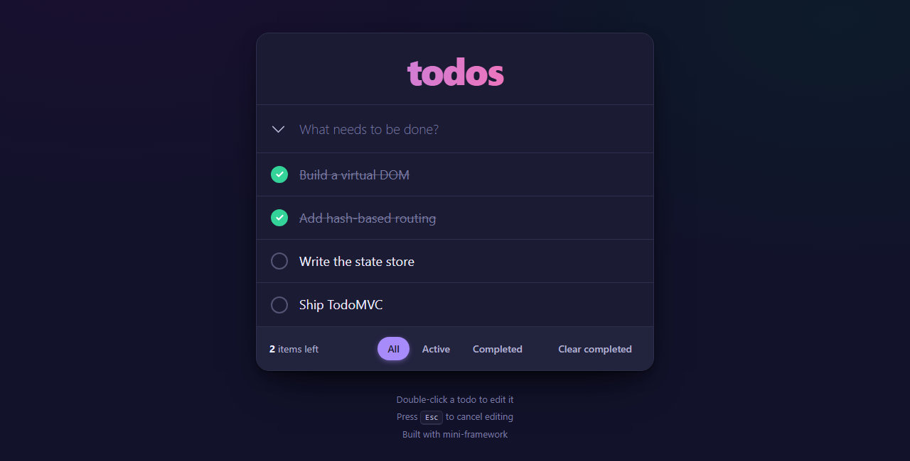

# Mini-Framework

A lightweight front-end JavaScript framework built **from scratch**, with zero dependencies and no build step. It includes a virtual DOM with keyed diffing, a state store, a hash router and a custom event system. A complete **TodoMVC** app built with it is included.




## Why

To understand what frameworks like React and Vue do under the hood, this project rebuilds their core ideas: describing the UI as data, updating the DOM efficiently, keeping state in one place and reacting to URL changes.

## Features

| Feature | Module | Description |
|---|---|---|
| **DOM abstraction** | [`vdom.js`](framework/vdom.js) | `h()` creates virtual nodes; mounting and keyed diff/patch update only what changed |
| **State management** | [`state.js`](framework/state.js) | A central `Store` with get, set and subscribe; changes trigger a re-render |
| **Routing** | [`router.js`](framework/router.js) | Hash-based routes with named parameters (`#/user/:id`) |
| **Event handling** | [`events.js`](framework/events.js) | A handler registry with one root dispatcher instead of `addEventListener` on each element; keyboard bindings via `onKey` |
| **Components** | [`component.js`](framework/component.js) | A `Component` base class with lifecycle hooks (`onMount`, `onUnmount`) and refs |
| **App wiring** | [`app.js`](framework/app.js) | `createApp()` connects the store, router and renderer |

## Quick Example

```js
import { createApp, Component, h } from "./framework/index.js";

const app = createApp({ root: "#app", state: { count: 0 } });

class Counter extends Component {
  render() {
    const count = this.getState("count", 0);
    return h("main", {}, [
      h("h1", {}, [`Count: ${count}`]),
      h("button", { onClick: () => this.setGlobalState("count", (n) => n + 1) }, ["+1"]),
    ]);
  }
}

app.route("/", Counter);
app.start();
```

## Getting Started

**Requirements:** Node.js 18+ (only to serve the files; the framework itself has no dependencies)

```bash
git clone https://github.com/ahmed-jawher/mini-framework.git
cd mini-framework
npm start
```

Open <http://localhost:3000> to try the TodoMVC demo. Its routes are `#/`, `#/active` and `#/completed`.

The framework uses ES modules, so it must be served over HTTP. Any static server works.

## Use It in Your Own Project

Copy the `framework/` folder into your project and import everything from its single entry point:

```js
import { createApp, Component, h } from "./framework/index.js";
```

The full API reference, with examples for creating elements, attributes, nesting, events, state, routing, components and refs, is in **[documentation.md](documentation.md)**.

## Project Structure

```text
mini-framework/
├── framework/          # the framework itself
│   ├── index.js        # public entry point
│   ├── vdom.js         # virtual DOM: createElement, mount, keyed diff/patch
│   ├── events.js       # event system
│   ├── state.js        # state store
│   ├── router.js       # hash router
│   ├── component.js    # Component base class and lifecycle
│   └── app.js          # ties everything together
├── todomvc/            # TodoMVC app built with the framework
├── documentation.md    # full API documentation
├── index.html
└── serve.js            # zero-dependency static file server
```

## Built With It

- [Bomberman DOM](https://github.com/ahmed-jawher/bomberman-dom): a real-time multiplayer game whose UI runs on a version of this framework

## Author

**Ahmed Jawher** — [@ahmed-jawher](https://github.com/ahmed-jawher)
